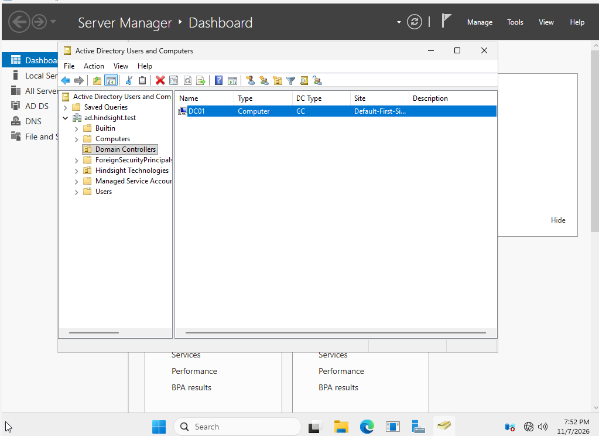

# Active-Directory-Home-Lab
Hands-on Windows Server and Active Directory home lab demonstrating domain administration, virtualization, and IT troubleshooting skills
# Active Directory Home Lab

## Project Overview

This project documents my hands-on experience building and administering a virtualized Windows Server environment using Oracle VirtualBox.

The purpose of this lab is to develop practical skills in Windows Server administration, Active Directory Domain Services (AD DS), IT infrastructure, and troubleshooting.

This project is part of my ongoing preparation for an entry-level career in IT support, systems administration, and networking.

## Technologies Used

- Oracle VirtualBox
- Windows Server
- Active Directory Domain Services (AD DS)
- Windows Server Manager
- Windows administration and troubleshooting

## Lab Environment

| Component | Description |
|---|---|
| Hypervisor | Oracle VirtualBox |
| Server | Windows Server |
| Virtual machine | DC01 |
| Server role | Active Directory Domain Services |
| Environment | Virtualized home lab |

## Completed Lab Activities

### 1. Virtual Machine Setup

- Created a Windows Server virtual machine named DC01 using Oracle VirtualBox.
- Configured the virtual machine environment for Windows Server administration.
- Prepared the server for Active Directory installation.

### 2. Active Directory Installation

- Installed the Active Directory Domain Services role.
- Used Windows Server Manager to begin domain controller promotion.
- Configured the Directory Services Restore Mode (DSRM) password.
- Successfully completed domain controller promotion.
- Verified that DC01 was promoted successfully.

### 3. Troubleshooting and Recovery

During the lab, I encountered a VirtualBox storage error:

`VERR_DISK_FULL`

The host computer had exhausted its available storage, causing the virtual machine to become unresponsive.

**Resolution:**

1. Identified insufficient host disk space as the cause.
2. Freed approximately 151 GB of storage space.
3. Safely powered down the unresponsive virtual machine.
4. Restarted DC01 and verified that the Windows Server environment was accessible.
5. Continued and successfully completed the domain controller promotion.

**Skills demonstrated:**
- Virtual machine troubleshooting
- Storage resource management
- Problem identification and resolution
- System recovery and verification

## Planned Lab Exercises

The following activities will be documented as they are completed:

- Create organizational units (OUs).
- Create and manage Active Directory user accounts.
- Configure security groups.
- Join a Windows client computer to the domain.
- Configure Group Policy Objects (GPOs).
- Practice password resets and account unlocks.
- Troubleshoot DNS and domain connectivity.
- Explore PowerShell for Active Directory administration.

## Project Goals

The long-term goal of this project is to develop a working understanding of enterprise Windows environments and the responsibilities commonly performed by help desk technicians, desktop support specialists, and junior systems administrators.

This repository will be updated as additional exercises are completed.
### Domain Controller Verification

After installing Active Directory Domain Services, I promoted DC01 to a domain controller for the `ad.hindsight.test` domain.

Using Active Directory Users and Computers (ADUC), I verified that:

- The domain `ad.hindsight.test` was accessible.
- DC01 appeared in the Domain Controllers organizational unit.
- DC01 was identified as a Global Catalog (GC) server.

The screenshot below documents the successful registration of DC01 in Active Directory.

## Active Directory User Account Management

### Organizational Unit Configuration

Created a fictional company structure within the `ad.hindsight.test` domain to simulate an enterprise Active Directory environment.

Organizational units created:

- Hindsight-Corp
  - IT
  - Human Resources
  - Sales
  - Workstations

### Employee Account Creation

Created a fictional employee account for Daniel Reeves (`dreeves`) within the IT organizational unit.

Configured the following attributes:
- Job title: Junior IT Support Specialist
- Department: IT
- Company: Hindsight-Corp
- Required password change at next logon

### Help Desk Exercise: Password Reset

Simulated a help desk ticket in which an employee forgot their password.

**Actions performed:**
1. Located the employee account using Active Directory Users and Computers.
2. Opened the password reset interface.
3. Assigned a new temporary password.
4. Required the employee to change their password at next logon.
5. Received confirmation that the password reset was successful.

**Skills demonstrated:**
- Active Directory user provisioning
- Organizational Unit management
- User account administration
- Password reset procedures
- Basic identity and access management

**Note:** The password reset was confirmed in Active Directory. Authentication using the new password will be tested after configuring a domain-joined Windows client.
